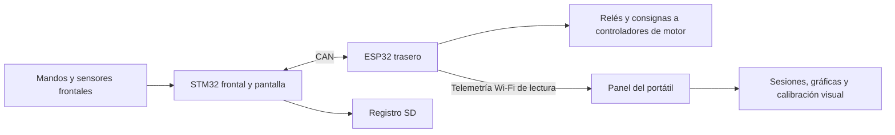

# Dossier para profesores · 13 de octubre de 2026

Este repositorio presenta el trabajo de continuación del kart realizado entre el 28 de septiembre y el 13 de octubre de 2026. La propuesta 2026/27 plantea diferencial electrónico inteligente y estimación de autonomía real hasta febrero de 2027; se solicita orientación para concretar la aportación, el alcance y los criterios de aceptación. [Propuesta y planificación](../06_TRABAJO/INICIO_INVESTIGACION_2026-27.md).

El punto de partida es un vehículo y una documentación de cursos anteriores. Se separan aquí la arquitectura heredada, el nuevo desarrollo y la validación todavía necesaria. La autonomía sigue como objetivo de investigación; no se presenta un estimador de autonomía implementado o validado.

## Recorrido de diez minutos

| Lectura | Qué permite valorar |
|---|---|
| Este dossier | Aportación, resultados, límites y prioridades |
| [Panel: captura 3D](../06_TRABAJO/evidencias/calibracion_pasos_2026-10-11/panel-3d-demo.png) y [calibración](../06_TRABAJO/ensayos/ENS-0012_calibracion_por_pasos.md) | Observación de señales y preparación de ensayos; imágenes de datos sintéticos |
| [Revisión del control heredado](../06_TRABAJO/REVISION_CODIGO_V12_2026-10-08.md) y [mejoras A01–A12](../06_TRABAJO/IMPLEMENTACION_ROBUSTEZ_V13.md) | Diagnóstico, prioridades y cambios razonados |
| [Índice de ensayos](../06_TRABAJO/ensayos/README.md) | Evidencia disponible y condiciones de cada resultado |
| [Tareas](../06_TRABAJO/TAREAS.md) | Qué requiere medida física o decisión académica |

## Arquitectura que se estudia

El esquema representa la organización documental y de software, no un esquema eléctrico verificado del montaje. [Síntesis heredada](../04_CONOCIMIENTO/integracion_del_kart/ESTADO_DOCUMENTADO_2025-26.md), [inventario del código](../04_CONOCIMIENTO/software_y_telemetria/INVENTARIO_CODIGO.md) y [protocolo de desarrollo v1.3](../07_DESARROLLO/firmware/common/PROTOCOLO_V13.md).

## Trabajo realizado y evidencia

| Periodo | Trabajo | Resultado y límite |
|---|---|---|
| 28–30 septiembre | Organización de la entrega, inventario, extracción y primeras síntesis; propuesta personal y cronograma | 42 fuentes históricas y 1.007 páginas PDF extraídas. Catalogar no equivale a leer integralmente; [plan por lotes](../06_TRABAJO/PLAN_DE_LECTURA.md) |
| 1–7 octubre | Estudio de arquitectura, alimentación, sensores, diagnóstico de arranque y preparación del panel | Hipótesis y mediciones pendientes registradas por problema. La compra de cargador requiere verificar configuración real de batería/BMS |
| 7–8 octubre | Respaldo ESP32, telemetría, detección de un desbordamiento CAN, regresión de marcha, recuperación y v1.2 de diagnóstico | Ensayos de banco USB/Wi-Fi; marcha posterior confirmada por Armando sin registro instrumentado de esa prueba. [ENS-0001–0004](../06_TRABAJO/ensayos/README.md) |
| 8–9 octubre | 3D y esquema desde fotos, animación de ruedas, auditoría del firmware y robustez v1.3 | Visualización aproximada; pruebas con señales sintéticas. Firmware compilado sin ensayo físico de las nuevas correcciones. [ENS-0005–0010](../06_TRABAJO/ensayos/README.md) |
| 11 octubre | STOP conservado al recibir STOP→START en un lote CAN; calibración con colocación y medición explícitas | Regresión STOP: cuatro fallos reproducidos antes y cero después; seis registros Wi-Fi anteriores analizados sin centro aceptado. [ENS-0011](../06_TRABAJO/ensayos/ENS-0011_stop_en_lote_can.md), [ENS-0012](../06_TRABAJO/ensayos/ENS-0012_calibracion_por_pasos.md) |
| 13 octubre | START momentáneo con memoria y antirrebote en STM32 dev3 | 19 fallos antes y cero después en 83 comprobaciones frontal/integración; 56 del control trasero satisfactorias. Compilación ARM correcta. Solo PC. [ENS-0013](../06_TRABAJO/ensayos/ENS-0013_start_stop_momentaneo.md) |

## Configuración y grado de validación

| Elemento | Desarrollo entregado | Correspondencia física |
|---|---|---|
| ESP32 | `esp32_trasero-v1.3-dev3` | Última grabación documentada: v1.2 el 07-10; declaración «B1.3» el 13-10 sin identificación de binario |
| STM32 | `stm32_frontal-v1.3-dev3` | Firmware instalado y contenido QSPI sin identificar/resguardar |
| Panel | `0.4.0-calibracion-pasos`, con ajustes de publicación documentados | Aplicación de PC; no programa las placas ni transmite mandos |
| Batería, sensores y geometría | Parámetros heredados identificados en fuentes | Armando declara 16 celdas; configuración activa BMS, PPR, centros, topes y dimensiones por contrastar |

La marcha satisfactoria comunicada el 08-10 es una **declaración del usuario**. Las comprobaciones dev3 son **pruebas de software** con entradas controladas. Los registros USB/Wi-Fi del módulo fuera del kart son **pruebas de banco**. Cada ficha conserva esa distinción y los resultados negativos. No se suman comprobaciones de distintas fechas como si fueran ensayos físicos independientes.

El límite R de 20 km/h corta propulsión según la velocidad estimada; no añade frenado eléctrico ni garantiza velocidad física en pendiente. ESC sigue experimental. La calibración del panel afecta únicamente a la representación en el portátil; no corrige los ADC del control. El modelo 3D no es un CAD medido. Referencias: [DEC-0006](../05_DECISIONES_Y_PROBLEMAS/decisiones/DEC-0006_robustez_v13_y_limite_marcha_atras.md), [ENS-0005](../06_TRABAJO/ensayos/ENS-0005_calibracion_direccion_panel.md), [ENS-0006](../06_TRABAJO/ensayos/ENS-0006_modelo_visual_fotografias.md).

## Comentarios que serían especialmente útiles

1. **Aportación académica:** ¿qué parte del diferencial y de la estimación de autonomía debe priorizarse y cómo distinguirla del sistema heredado?
2. **Plan experimental:** ¿qué magnitudes, repeticiones y criterios de aceptación conviene fijar antes de validar DIF/BLQ/ESC y consumo/autonomía?
3. **Secuencia de validación:** revisar identificación/respaldo frontal y QSPI → banco → pruebas estáticas → ensayo integrado registrado por Wi-Fi. El USB del ESP32 no es accesible instalado.
4. **Dirección y arranque:** revisar los procedimientos de [PROB-0007](../05_DECISIONES_Y_PROBLEMAS/problemas/PROB-0007_variacion_y_centro_direccion.md) y [PROB-0009](../05_DECISIONES_Y_PROBLEMAS/problemas/PROB-0009_start_pulsador_momentaneo.md), separando el defecto reproducido de las posibles causas eléctricas aún sin medir.
5. **Alcance y calendario:** acordar entregables realistas, instrumentación disponible y prioridad de BMS, alimentación, pantalla y calibraciones.

Para dejar feedback: **[abrir una revisión académica](https://github.com/armandos52/kart-electrico/issues/new?template=revision_academica.md)** o [iniciar una discusión](https://github.com/armandos52/kart-electrico/discussions). Basta citar documento/sección, observación y comprobación sugerida. También se puede enviar esa información por el canal académico habitual. [Guía](../CONTRIBUTING.md).

## Fuentes y reproducibilidad

También se incluye la [consulta documental de batería del 13-10](../04_CONOCIMIENTO/bateria_y_bms/TUTORIAL_CELDAS_Y_CARGA_16S.md), incorporada mientras se preparaba la entrega: cálculos 16S, diferencia entre tensión y SOC y discrepancia de capacidad entre fuentes. [PROB-0010](../05_DECISIONES_Y_PROBLEMAS/problemas/PROB-0010_identificacion_y_carga_bateria_16s.md) mantiene pendiente la identificación del conjunto. No es una carga realizada ni una configuración aplicada.

[Código y comandos](../07_DESARROLLO/README.md) · [versiones](../07_DESARROLLO/firmware/VERSIONES.md) · [diario](../06_TRABAJO/DIARIO_PARA_RELATORIO.md) · [catálogo](../03_CATALOGO/INDICE_DOCUMENTOS.md) · [alcance público](../02_ORIGINALES/README.md).

Los informes históricos completos se conservan en la copia local; el catálogo mantiene nombres, hashes, páginas y cobertura. La revisión de publicación no amplía su lectura técnica ni acredita una copia de seguridad independiente.

Última incorporación del 13-10: [ENS-0014 · plan de carga completa y referencia SOC](../06_TRABAJO/ensayos/ENS-0014_carga_completa_bateria_16s.md), previsto para esta semana. Identificación de equipos y criterios de finalización pendientes; sin datos ni carga ejecutada.
