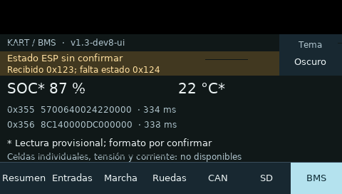
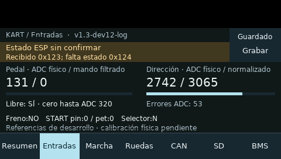

# Avances de estas semanas · corte del 26-10-2026

Objetivo: reunir el trabajo acumulado para revisión y ordenar el diagnóstico de dirección y la búsqueda de IMU. Se distinguen pruebas de PC, observaciones de placa y declaraciones de Armando. Esta publicación no añade un ensayo físico.

## Qué hemos hecho

| Periodo | Trabajo y resultado | Evidencia y límites |
|---|---|---|
| 13–15 octubre | Banco Nucleo F411, diez escenas de pantalla y preparación/instalación del frontal F746 | [Índice de ensayos](ensayos/README.md), ENS-0015 a ENS-0021. Banco con datos sintéticos y pruebas físicas diferenciados |
| 15–16 octubre | Dashboard de diagnóstico, táctil, correcciones CAN/Hall/SD y BMS visible | [ENS-0023](ensayos/ENS-0023_bugs_e_instalacion_dashboard.md), [ENS-0024](ensayos/ENS-0024_bms_visible_diagnostico.md). SOC/temperatura BMS aún provisionales |
| 17 octubre | Revisión de reversa y modos de diferencial; reproducción de problemas de control en PC | [ENS-0025](ensayos/ENS-0025_revision_diferencial_y_reversa.md). Reversa y dinámica real pendientes; resultados negativos conservados |
| 21 octubre | Diagnóstico de marchas, ajuste del pedal y firmware frontal dev9; desarrollo del filtro dev10 | [ENS-0026](ensayos/ENS-0026_diagnostico_bloqueo_marchas.md), [ENS-0027](ensayos/ENS-0027_pedal_media_ponderada.md). ESP32 identificado v1.2 por Wi-Fi; IMU no disponible |
| 22–23 octubre | Historial microSD, biblioteca/replay en el panel, oscuro fijo y botón Grabar/Detener | [ENS-0029](ensayos/ENS-0029_instalacion_historial_sd.md). Dev11 falló con TX_UNDERRUN; dev12 con DMA instalada y verificada. Sesiones cerradas de 1.184 y 989 filas según firmware; lectura independiente/replay real pendientes |
| 23 octubre | Investigación del ADC de dirección y estudio PID/IMU | [Investigación](INVESTIGACION_ADC_DIRECCION_2026-10-23.md), [guía](../04_CONOCIMIENTO/software_y_telemetria/GUIA_PID_E_IMU.md). Simulaciones didácticas; no medidas dinámicas del kart |
| 26 octubre | Nuevo hallazgo comunicado sobre el condensador y organización de la selección IMU | Declaración de Armando recogida debajo; sin reparación ni medida nueva acreditadas |

## Potenciómetro de dirección: hallazgo comunicado el 26-10

Armando informa de ruido en el potenciómetro del volante usado para estimar la posición de las ruedas. Identifica como error crítico un condensador conectado entre **masa y «REF»**, cuando en su montaje debía ir entre **masa y VCC**. Atribuye a este error la pérdida de aproximadamente la mitad de los valores aprovechables del ADC.

Es un diagnóstico comunicado por el usuario, pendiente de evidencia antes/después. «REF» conserva su denominación: falta identificar si corresponde al cursor, a una referencia del circuito o a otra red. No se deduce de esta frase una modificación universal de condensadores de referencia. Tampoco se afirma borrado de memoria del ADC: lo descrito es pérdida de recorrido útil de lectura. No constan valor/tipo del condensador, esquema marcado, fotografía del punto, fecha de reparación ni mediciones que confirmen recuperación. No se atribuyen automáticamente a él los 53 errores ADC de ENS-0029.

Configuración documental más reciente: STM32 F746 **dev12-log**, con filtro de pedal dev10; ESP32 **v1.2-diagnostico** identificado el 21-10, sin actualización trasera en ENS-0029. La configuración exacta durante el hallazgo del condensador no está confirmada.

Siguiente ensayo: conservar esquema/fotos del montaje inicial y corregido, identificar componente y redes, registrar versión real, alimentación, condiciones y posiciones centro/topes. Comparar tensión y ADC bruto, ruido y repetibilidad antes/después con condiciones equivalentes. Registrar resultados favorables y negativos y conservar logs originales. Adquisición integrada por Wi-Fi; USB del ESP32 únicamente fuera del kart. [Problema de dirección](../05_DECISIONES_Y_PROBLEMAS/problemas/PROB-0007_variacion_y_centro_direccion.md).

## IMU: objetivo y trabajo pendiente

Armando comunica que está buscando un chip/módulo IMU para continuar los modos de diferencial que requieren información inercial y ampliar la telemetría del vehículo. No hay modelo elegido, compra, instalación ni nuevos modos validados. [PROB-0017](../05_DECISIONES_Y_PROBLEMAS/problemas/PROB-0017_imu_no_disponible.md) conserva `mpu_ok=0` en el ESP32 v1.2; esa bandera no identifica por sí sola la causa.

Orden de trabajo: identificar el módulo existente y su alimentación/conexión; concretar señales requeridas por cada modo; comparar candidatos por interfaz y niveles eléctricos, disponibilidad de controlador, rango, ruido, frecuencia/latencia y montaje; después validar orientación de ejes, cero, deriva, sincronización y pérdidas en telemetría. La guiñada y aceleraciones deben distinguirse de posición o velocidad estimadas. La selección de un chip no habilita automáticamente ESC ni acredita estabilidad dinámica. Primero banco y adquisición, después validación del control con criterios definidos.

## Fotos y capturas disponibles

Se conservan las tres vistas públicas del kart en la [portada](../README.md) y la [galería del LCD del banco](evidencias/nucleo_vistas_2026-10-14/GALERIA.md). No se han recibido fotos nuevas del condensador en esta sesión.

*Captura del framebuffer real; no es fotografía del panel ni validación definitiva del protocolo BMS.*

*Captura digital durante ENS-0029. El contenido de los archivos de tarjeta requiere lectura independiente.*

## Prioridades

1. Documentar y contrastar el hallazgo del condensador; recuperar y calibrar el recorrido útil de dirección con medidas.
2. Identificar/seleccionar IMU y obtener telemetría inercial válida antes de ensayar modos dependientes.
3. Recuperar los archivos microSD y validar replay, persistencia y fallos de tarjeta.
4. Resolver reversa y validar pedal, dirección y control por etapas. Mantener pantallas de diagnóstico.

La publicación incluye fuentes, fotos públicas, capturas y registros publicables. Los originales históricos, credenciales y volcados de memoria excluidos por las reglas del repositorio permanecen locales; no se anuncia copia independiente completa.
