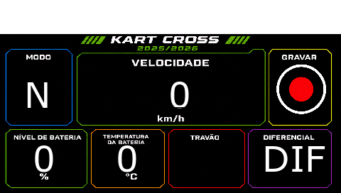
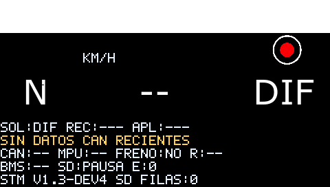
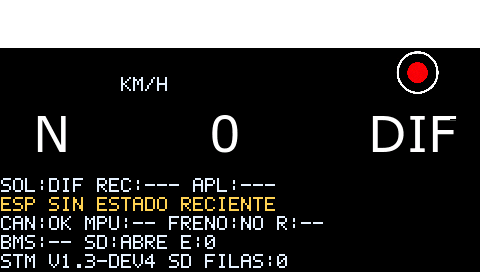
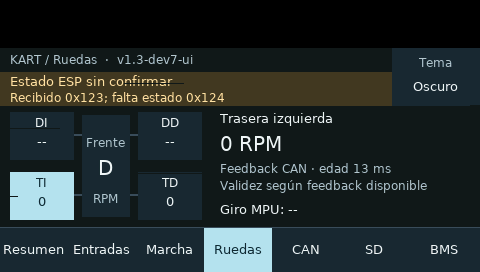
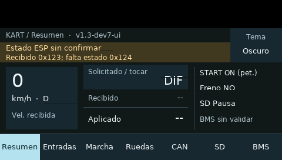
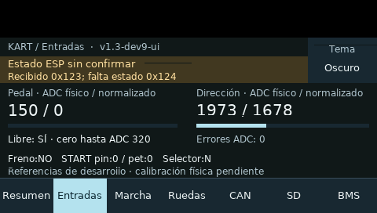
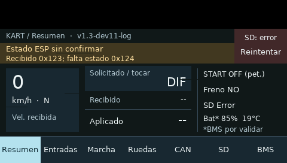
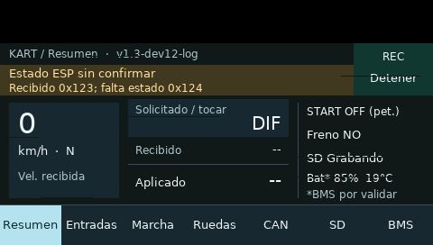
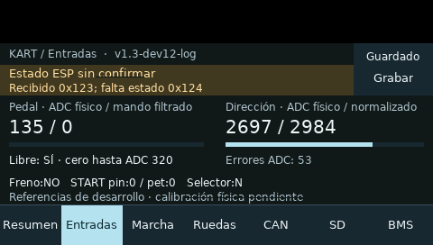

# Galería de pruebas de pantalla

Publicado el 26-10-2026. Reúne **14 capturas digitales del frontal F746** ya conservadas en los ensayos, más las galerías de banco y simulación. Son lecturas de memoria gráfica, no fotografías del cristal; no acreditan brillo, daño físico o respuesta táctil por sí solas. No se han realizado pruebas nuevas para esta galería.

[Estado actual](../00_INICIO/ESTADO_ACTUAL.md) · [Índice de ensayos](ensayos/README.md) · [Avances de estas semanas](AVANCES_2026-10-26.md)

## 15-10 · Frontal F746: antes y después de dev4

Capturas del framebuffer de la F746 durante la identificación e instalación. Conservan el estado de cada momento del ensayo. [Ensayo y límites](ensayos/ENS-0019_frontal_dev4_f746_real.md).

### Antes de instalar, firmware original

[Ver PNG original](evidencias/frontal_f746_2026-10-15/antes_original/pantalla.png)

### Dev4: arranque

[Ver PNG original](evidencias/frontal_f746_2026-10-15/dev4_arranque/pantalla.png)

### Dev4: después de las pulsaciones

[Ver PNG original](evidencias/frontal_f746_2026-10-15/dev4_tras_toques/pantalla.png)

### Dev4: estado final

[Ver PNG original](evidencias/frontal_f746_2026-10-15/dev4_final/pantalla.png)

## 16-10 · Dashboard y correcciones

Capturas reales de la instalación y observaciones posteriores del dashboard. [Ensayo y límites](ensayos/ENS-0023_bugs_e_instalacion_dashboard.md).

### Arranque real

[Ver PNG original](evidencias/frontal_bugs_2026-10-16/arranque_real/pantalla.png)

### Segunda observación

[Ver PNG original](evidencias/frontal_bugs_2026-10-16/observacion_2/pantalla.png)

### Tercera observación

[Ver PNG original](evidencias/frontal_bugs_2026-10-16/observacion_3/pantalla.png)

## 16-10 · BMS visible, dev8

Interpretación del BMS provisional: la captura no confirma por sí sola el protocolo ni la precisión del SOC. [Ensayo y límites](ensayos/ENS-0024_bms_visible_diagnostico.md).

### Arranque real con BMS

[Ver PNG original](evidencias/bms_dashboard_2026-10-16/arranque_real/pantalla.png)

## 21-10 · Diagnóstico de marchas

Observación del frontal durante el ensayo de diagnóstico de marchas. Consultar la ficha para versión y condiciones exactas de cada fase. [Ensayo y límites](ensayos/ENS-0026_diagnostico_bloqueo_marchas.md).

### Observación en placa

[Ver PNG original](evidencias/marchas_2026-10-21/observacion_host/pantalla.png)

## 23-10 · Historial microSD: dev11 y dev12

Se conserva el resultado negativo de dev11 (TX_UNDERRUN) y las capturas posteriores de dev12 con DMA. Lectura independiente de archivos microSD y replay real pendientes. No se realizó ensayo de tracción. [Ensayo y límites](ensayos/ENS-0029_instalacion_historial_sd.md).

### Estado previo a la instalación

[Ver PNG original](evidencias/instalacion_dev11_2026-10-23/antes_host/pantalla.png)

### Dev11: arranque del ensayo con fallo SD

[Ver PNG original](evidencias/instalacion_dev11_2026-10-23/arranque/pantalla.png)

### Dev12: arranque

[Ver PNG original](evidencias/instalacion_dev11_2026-10-23/dev12/arranque/pantalla.png)

### Dev12: observación de estado SD

[Ver PNG original](evidencias/instalacion_dev11_2026-10-23/dev12/estado_sd/pantalla.png)

### Dev12: captura final de Entradas

[Ver PNG original](evidencias/instalacion_dev11_2026-10-23/dev12/final/pantalla.png)

## Banco F411 y vistas sintéticas

- [Diez escenas del LCD del banco F411, 14-10](evidencias/nucleo_vistas_2026-10-14/GALERIA.md): capturas de la memoria gráfica del LCD real, con datos del kart sintéticos.
- [Dashboard claro/oscuro, 16-10](evidencias/frontal_dashboard_2026-10-15/GALERIA.md): renders de comprobación en PC; no fotografías ni mediciones del kart.

Los PNG originales se enlazan sin modificación ni duplicación. Los datos, logs y condiciones se conservan en cada ensayo.
