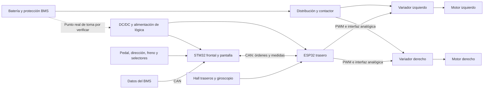

# Aprender el kart: historia, funcionamiento y mejoras

Preparada para Armando el 07-10-2026. Objetivo: poder explicar qué hace cada sistema, por qué está ahí, cómo se relaciona con los demás y cómo comprobar una mejora. Esta guía reúne lo ya conocido y una consulta focalizada nueva; **no significa que estén leídos íntegramente los 43 documentos ni que hayas completado tú el estudio**.

## 1. Cómo reconocer la certeza de un dato

- **D — Documentado:** está en una fuente identificada. Describe esa configuración o lo que declararon sus autores; no acredita por sí solo el montaje actual.
- **U — Usuario:** lo has confirmado o descrito tú, con fecha.
- **H — Hipótesis:** explicación posible, pendiente de una prueba que la distinga de otras.
- **P — Pendiente:** falta identificación, lectura visual, medición o respuesta.

**U, 07-10-2026:** confirmas 16 celdas de batería y tienes el kart contigo. Ya habías declarado 16 funcionales el 01-10. **P:** confirmar conexión 16S activa, las 16 lecturas del BMS y sus parámetros actuales. No trasladar la tabla histórica 15S al montaje actual.

**U, 07-10-2026:** quieres mejorar la pantalla y la PCB; describes energía que queda al desconectar el contactor, la atribuyes a los variadores y dices que afecta al programa. **P:** qué dispositivo sigue alimentado, duración, tensión, condiciones y forma de recuperación. **H:** que la carga de los variadores llegue a la lógica por una vía concreta. [Registro de esta sesión](SESION_ESTUDIO_2026-10-07.md).

## 2. Historia: qué cambió y qué debemos aprender

La [auditoría del 29-09](AUDITORIA_2026-09-29.md), sección 1, ofrece el mapa general. Sus detalles sin marca [V] siguen pendientes de contraste; no se convierten aquí en especificaciones actuales. Las páginas siguientes son **páginas PDF**, no necesariamente las impresas.

| Etapa | Evolución y resultado | Lección para tu trabajo | Evidencia y alcance |
|---|---|---|---|
| 2008/09 | Antecedente de diferencial eléctrico con PIC y electrónica de potencia propia. La auditoría lo identifica como banco de laboratorio, previo al kart convertido. | Comprender la idea de dos motores independientes antes de estudiar la implementación actual. | [DOC-0023](../03_CATALOGO/fichas/DOC-0023.md); resumen de auditoría, sección 1. Detalles del banco pendientes de comprobación directa; esta sesión consultó solo PDF 5, índice. |
| 2010/11 | El informe describe sustituir el motor de combustión del KartCross por dos motores eléctricos y añadir baterías, control e instrumentación. | La conversión del vehículo y los antecedentes de laboratorio pueden tener fechas diferentes. | [DOC-0024](../03_CATALOGO/fichas/DOC-0024.md), PDF 5, resumen consultado. No resuelve por sí solo todas las diferencias sobre el inicio. |
| 2013/14 | Tras reparación y reconstrucción de conexiones, el kart terminó sin funcionar por el conjunto motor-controlador derecho. | Comprobar cada cadena completa: orden, electrónica, variador y motor. | [DOC-0025](../03_CATALOGO/fichas/DOC-0025.md), PDF 109, conclusión consultada. |
| 2015/16 | Diferencial electrónico con Arduino; el informe declara funcionamiento, pero control en lazo abierto y PID sin ajuste satisfactorio. También conserva problemas de frenos, suspensión y neumáticos. | Calcular una consigna no demuestra que la rueda real la cumpla; la mecánica también condiciona el resultado. | [DOC-0026](../03_CATALOGO/fichas/DOC-0026.md), PDF 47, conclusión consultada. |
| 2018/19 | Trabajo de batería/BMS y diferencial; el fallo de la placa OUT impidió los ensayos previstos de autonomía y del nuevo diferencial. | Distinguir un algoritmo programado de uno ensayado y validado. | [DOC-0002](../03_CATALOGO/fichas/DOC-0002.md), PDF 60, conclusión consultada. |
| 2023/24 | Arduino y mejoras del diferencial. El informe final pide sensores de corriente, registro de datos y mejoras de frenos, neumáticos y desconexión general. | Medir corriente, velocidad y comportamiento permite pasar de impresiones a resultados. | [DOC-0027](../03_CATALOGO/fichas/DOC-0027.md), PDF 67, conclusión consultada; arquitectura detallada en auditoría. Hay otra versión, DOC-0022. |
| 2024/25 | Migración a STM32. Se retiró una celda averiada y se operó con 15; el código inventariado aplicaba la misma salida a ambos motores. | Una migración puede conservar funciones y perder otras. Un esquema de batería antiguo no describe automáticamente el kart de hoy. | [DOC-0003](../03_CATALOGO/fichas/DOC-0003.md), PDF 44, texto consultado; [inventario de código](../04_CONOCIMIENTO/software_y_telemetria/INVENTARIO_CODIGO.md), sección 3. Fecha de portada contradictoria. |
| 2025/26 | STM32 frontal con pantalla + ESP32 trasero + CAN y BMS. DIF y BLQ ensayados según las conclusiones; ESC no validado. Fallos de contactor y ESP32 en marcha. | La arquitectura modular facilita diagnosticar, pero necesita alimentación estable y supervisión de comunicaciones. | [DOC-0042](../03_CATALOGO/fichas/DOC-0042.md), PDF 5, 90–91, 96–98; [síntesis](../04_CONOCIMIENTO/integracion_del_kart/ESTADO_DOCUMENTADO_2025-26.md). |
| Tu etapa 2026/27 | Propuesta de diferencial y autonomía; ahora añades mejora de pantalla y PCB/apagado. Confirmas 16 celdas. | Definir problema, medir antes, modificar, repetir la misma prueba y documentar el resultado. | [DOC-0043](../03_CATALOGO/fichas/DOC-0043.md), [ideas](IDEAS.md), declaración del 07-10. Mejoras aún sin diseño aprobado. |

Faltan informes de varios cursos; los huecos no prueban que no hubiera trabajo. Las dudas de fechas y versiones se conservan en [PROB-0001](../05_DECISIONES_Y_PROBLEMAS/problemas/PROB-0001_versiones_documentales.md). No afirmar que la autonomía nunca se midió: por ahora no tenemos un ensayo validado identificado en la documentación revisada.

**Comprueba que lo entiendes:** explica la diferencia entre antecedente, conversión física, función programada y función validada. Después di qué cambió de Arduino a STM32 y de STM32 único a STM32 + ESP32.

## 3. El mapa que debes tener en la cabeza

Hay un recorrido de **energía** y otro de **información**. La PCB y los microcontroladores dan órdenes; los variadores conmutan la potencia que mueve los motores.

Es un mapa funcional de 2025/26, **no un esquema de cableado**. No fija la posición exacta del BMS, fusibles, precarga, masas o toma del DC/DC. Fuente: DOC-0042, PDF 5, 43, 49; inventario de código, secciones 3–4. Debemos contrastarlo con tu montaje.

## 4. Batería y BMS: qué significan los números

Una celda almacena energía; un pack conecta varias. En serie se suman las tensiones, pero no los Ah. El informe 2025/26 describe celdas Winston LiFePO4 de **3,3 V nominales y 60 Ah**, 16 en serie en su descripción inicial (DOC-0042, PDF 69). Más adelante documenta 15 activas y una sustitución pendiente (PDF 85, consulta previa de compra). Son estados históricos diferentes.

**Cálculo didáctico con los valores declarados en el informe:** 16 × 3,3 V = 52,8 V nominales; 52,8 V × 60 Ah ≈ 3.168 Wh. Esto no mide la capacidad actual ni la energía utilizable. Edad, temperatura, desequilibrio, límites de protección y carga real cambian lo que puedes extraer. Tampoco fija una tensión de cargador.

El BMS observa celdas y aplica protecciones; algunos modelos además equilibran y estiman SOC. El cargador aporta un perfil de carga adecuado. **El BMS no sustituye al cargador y un límite de protección no es la consigna normal de carga.** Una celda puede alcanzar su límite antes que las demás y detener el conjunto aunque la tensión total parezca razonable.

SOC es una estimación del porcentaje de carga, no una medición directa de los kilómetros restantes. Para autonomía necesitas energía utilizable y consumo en condiciones definidas. La nota de [compra](COMPRA_CARGADOR_Y_NEUMATICOS.md) conserva la tabla histórica del BMS y sus límites de aplicación.

**Comprueba que lo entiendes:** ¿por qué 16 celdas de 60 Ah en serie no son 960 Ah? ¿Por qué no basta medir la tensión total para saber si todas las celdas están bien? ¿Qué distingue SOC de autonomía?

## 5. Contactor, relés, DC/DC y energía al apagar

El contactor es un interruptor de potencia accionado por una bobina. Un relé pequeño puede controlar esa bobina; no conduce necesariamente la corriente de los motores. El DC/DC reduce la tensión del pack para alimentar la lógica. DOC-0042, PDF 49, declara un cambio de 2,5 W a **5 V / 10 W**, con entrada de **36–72 V**; es información del informe, con modelo físico aún pendiente.

DOC-0042, PDF 74, describe dos etapas para la **bobina**: tensión completa al cerrar, después alimentación a través de resistencias para reducir calentamiento. Se ensayaron 180 Ω y luego dos de 180 Ω en paralelo, equivalentes a 90 Ω. **Ese circuito no acredita una precarga de los condensadores de los variadores.** Los nombres de relés del informe y del código también requieren contrastar el cableado.

Un condensador guarda energía eléctrica: E = ½ C V². Abrir un contacto corta una vía de alimentación, pero la tensión del condensador puede tardar en bajar. Además, una resistencia de precarga permanente, una alimentación separada de PWR o un USB podrían mantener parte del sistema alimentada. No sabemos cuáles de esas vías existen en tu kart.

Conviene separar tres funciones:

| Función | Momento | Propósito |
|---|---|---|
| Precarga | Antes de conectar directamente el bus de potencia | Limitar la corriente inicial que carga los condensadores. |
| Economización de bobina | Después de cerrar el contactor | Reducir consumo y calor de su bobina. |
| Descarga del bus | Al desconectar, según el diseño | Reducir la energía almacenada en los condensadores. |

El manual [Kelly KEB V3.4](https://media.kellycontroller.com/new/KellyKEBUserManualV3.4.pdf), páginas PDF 11 y 14, trata la precarga y los condensadores que necesitan descarga; consultas locales de DOC-0008 y DOC-0031 en [PROB-0003](../05_DECISIONES_Y_PROBLEMAS/problemas/PROB-0003_energia_residual_al_abrir_contactor.md). La topología real y el modelo deben comprobarse antes de aplicar el manual al montaje.

**Por qué podría afectar al programa:** una placa parcialmente alimentada puede no pasar por un apagado y un arranque limpios. Otra posibilidad es que una señal con tensión alimente indirectamente una placa apagada a través de su interfaz. Texas Instruments explica este mecanismo de realimentación en [SCDA015](https://www.ti.com/document-viewer/lit/html/SCDA015). Es un principio general; **no demuestra que sea la causa de tu fallo**. El informe ya describe optoacopladores en las señales hacia los variadores (PDF 43), por lo que debemos localizar cualquier vía real, no presuponer una conexión directa.

Tu idea de PCB queda orientada a medir y controlar ese apagado. La nota [PROB-0003](../05_DECISIONES_Y_PROBLEMAS/problemas/PROB-0003_energia_residual_al_abrir_contactor.md) separa observación, hipótesis y comprobaciones. Para estudiar ahora basta observar pantalla, luces y secuencia; no puentear el contactor, cortocircuitar condensadores ni sacar módulos con tensión.

**Comprueba que lo entiendes:** ¿por qué abrir el contactor no demuestra que toda la electrónica esté sin tensión? ¿Por qué una resistencia de bobina no descarga necesariamente el bus? ¿Qué dato falta para diseñar una descarga?

## 6. Motores, variadores y PWM

Un motor BLDC necesita conmutar sus fases en relación con la posición del rotor. El variador realiza esa conmutación y regula su actuación según sus entradas y configuración. Los Hall pueden informar de posición y también permitir estimar velocidad; no debemos confundir polos, pares de polos y pulsos usados por el programa.

El ESP32 no alimenta las fases del motor. Genera una orden PWM: una señal que alterna estados y cuya proporción de tiempo activo representa una consigna. En la electrónica descrita se convierte a una tensión mediante optoacoplador y filtro RC (DOC-0042, PDF 43–44). El informe declara **10 kΩ y 3,3 µF**, con τ = RC = **33 ms**; el código inventariado configura PWM a **5 kHz**, sección 4 del inventario. Son datos de capas distintas del sistema.

La polaridad de esa interfaz importa: no asumir que PWM alto equivale a motor parado ni que la tensión media es siempre 3,3 V multiplicada por el duty. El inventario registra lógica invertida y 255 como consigna de parada en el programa 2025/26. Esto todavía no demuestra el estado seguro ante un reset o un GPIO sin configurar.

El modo de un variador importa: una orden de par/corriente no garantiza una velocidad concreta. Una rueda descargada y otra cargada pueden girar distinto con órdenes iguales. Tampoco se puede identificar corriente de fase con corriente tomada de la batería. Debemos leer la configuración de cada lado antes de interpretar sus límites.

**Comprueba que lo entiendes:** recorre la cadena pedal → ADC → mensaje CAN → cálculo ESP32 → PWM → filtro → variador → motor. ¿Dónde podría originarse una diferencia entre las ruedas?

## 7. Sensores y diferencial electrónico

El ADC convierte una tensión analógica a un número. El programa usa calibraciones para convertirlo en acelerador o ángulo. Esas calibraciones necesitan comprobar cero, extremos, sentido y comportamiento con cable roto. El inventario identifica que el STM32 recorta lecturas altas del acelerador al máximo; un valor fuera de rango podría convertirse en una orden máxima. Es un defecto del fuente revisado, no una prueba de cuál es el firmware grabado.

Un Hall de rueda permite contar pulsos. Para pasar a rpm necesitas conocer **pulsos por vuelta** y tiempo de conteo; para velocidad lineal necesitas circunferencia efectiva. Los valores 89/68 del fuente requieren medición en el montaje. Un error de escala puede parecer un fallo de diferencial.

El giroscopio mide **velocidad angular**, por ejemplo guiñada en °/s; no entrega por ello un ángulo absoluto de dirección. Integrar esa velocidad para obtener un ángulo introduce deriva. El volante informa de intención de giro; la guiñada informa de cómo gira realmente el vehículo.

En una curva, la rueda exterior recorre más distancia. Para un giro ideal sin deslizamiento, con radio central R y semivía b, las velocidades siguen la relación (R+b)/(R−b). Un modelo sencillo usa R ≈ L/tan(δ), donde L es la distancia entre ejes y δ un ángulo equivalente de dirección. El ángulo del volante debe transformarse y calibrarse antes de usarse como δ; no son automáticamente iguales.

| Modo del programa 2025/26 | Idea | Límite que debes recordar |
|---|---|---|
| DIF | Reparto de consignas usando geometría de giro. | Una consigna geométrica no demuestra seguimiento de velocidad ni adherencia. |
| BLQ | Misma consigna PWM para ambas ruedas. | No es un bloqueo mecánico ni garantiza rpm iguales. |
| ESC | Añadir corrección usando guiñada medida frente a una referencia. | Las conclusiones no lo validan; el código también tiene un problema de signo registrado. |

Fuente: inventario, secciones 4 y 6; DOC-0042 PDF 96–97. Para un modelo de bicicleta, la referencia de guiñada es aproximadamente v/L × tan(δ), en rad/s si v está en m/s y L en m. La convención de signos y la conversión a °/s deben ser coherentes. Esto es teoría para estudiar, no una calibración aprobada del kart.

**Comprueba que lo entiendes:** ¿por qué BLQ puede dar rpm diferentes? ¿Cómo distingues un sensor mal calibrado de un control mal calculado? ¿Qué falta para llamar validado a ESC?

## 8. CAN, firmware y registro de datos

CAN transporta mensajes entre unidades. El identificador indica el tipo de mensaje según el protocolo elegido; ambos extremos deben acordar longitud, bytes, escala, unidades y frecuencia. La velocidad del bus no es la frecuencia con que se actualiza una medida.

| Mensaje en los fuentes inventariados 2025/26 | Dirección y finalidad |
|---|---|
| 0x100 | STM32 → ESP32: acelerador, dirección, freno, marchas, modo y START. |
| 0x123 | ESP32 → STM32: velocidad, rpm traseras y guiñada. |
| 0x355 | BMS → STM32: SOC según interpretación del código. |
| 0x356 | BMS → STM32: temperatura según interpretación del código. |

Referencia: auditoría, sección 2, e inventario, secciones 3–4. Bus de referencia **500 kbit/s**. El protocolo real del BMS instalado sigue pendiente de contrastar: no basta que el identificador coincida con un modo compatible Pylontech.

El fuente ESP32 corta las consignas de motor si no recibe orden en **100 ms**; el STM32 no vigila la antigüedad de todos los datos recibidos. Una pantalla puede conservar la última velocidad y hacerla parecer actual. Recibir un número correcto una vez no equivale a recibir información válida ahora.

Hay diferencias entre informe y código: DOC-0042 PDF 29 habla de lectura cada 20 ms; el inventario identifica un bucle frontal cada 5 ms o más. PDF 31 declara pantalla cada 100 ms; el inventario identifica una actualización cada 50 ms en una parte del código. Registrar estas diferencias; no elegir una cifra por la fecha del archivo.

FreeRTOS reparte la ejecución entre tareas. Pantalla, adquisición y SD deben intercambiar datos de forma coherente. `volatile` no basta para garantizar una foto consistente de varias variables compartidas; hacen falta mecanismos adecuados a la concurrencia. El inventario señala accesos desde varias tareas y problemas de cierre/reinicio de SD.

Para aprender el programa, seguir este orden: entrada y validación → estados y arranque → envío/recepción CAN → diferencial → salidas → registro → interfaz. Estudiar código propio antes de bibliotecas completas. La versión realmente grabada y las dependencias del ESP32 están pendientes.

El CSV histórico no coincide con el separador y periodo del STM32 final. No mezclar datos de un ensayo con un programa sin identificar su versión. Un registro útil debe guardar versión, condiciones, tiempo, sensores, estados, fallos y datos de batería. Referencia: inventario, secciones 5–7; [decisión de versiones y ensayos](../05_DECISIONES_Y_PROBLEMAS/decisiones/DEC-0001_versiones_de_firmware_y_ensayos.md).

**Comprueba que lo entiendes:** ¿qué debe mostrar la pantalla si deja de llegar CAN? ¿Por qué un programa puede arrancar con USB y fallar sin él? ¿Qué necesitas guardar para repetir un ensayo?

## 9. Tu mejora de pantalla

**D:** DOC-0042 PDF 31 describe TFT táctil de **480 × 272 píxeles** integrado en STM32F746G-DISCO, con TouchGFX. PDF 33 describe interacción de modo y Play/Pause. Esta sesión revisó texto; las capturas y la tabla 3 siguen pendientes de revisión visual.

**U:** quieres mejorarla. **P:** decidir si priorizas legibilidad, tamaño físico, menús, avisos o datos. No se ha elegido otra pantalla ni modificado el firmware.

Primera propuesta para discutir:

- Vista de conducción: velocidad, D/N/R, estado de habilitación, modo y avisos legibles de un vistazo.
- Vista de diagnóstico, estando parado: edad de los mensajes CAN, alimentación disponible si se mide, motivo de reinicio, versión y estado de SD.
- Datos sin actualizar: mostrar «sin datos» y antigüedad en lugar de conservar cifras como si fueran vigentes.
- Batería: distinguir tensión, SOC y autonomía estimada. Incorporar solo datos que existan y estén validados.
- Mantener las condiciones de cambio de marcha/modo; comprobar con el kart la función de cada botón.

Prueba de aceptación propuesta: identificar de un vistazo si el kart está habilitado y en qué marcha; simular pérdida de comunicación en banco y comprobar el aviso; verificar que Play/Pause vuelve a grabar y que el aviso corresponde al archivo real. Legibilidad al sol y con guantes requiere prueba física.

## 10. Tu mejora de PCB

La PCB debe resolver problemas medidos: alimentación, apagado, interfaces, montaje y diagnóstico. Tu propuesta queda registrada en [IDEAS](IDEAS.md) y [PROB-0003](../05_DECISIONES_Y_PROBLEMAS/problemas/PROB-0003_energia_residual_al_abrir_contactor.md).

Antes de dibujar una placa nueva necesitamos: esquema de la actual, modelo de variadores y DC/DC, rutas de alimentación y masas, señales que conservan tensión, protección del contactor y comportamiento del firmware al arrancar. Los PDF de capas por sí solos no garantizan que podamos reconstruir todas las conexiones.

Requisitos candidatos: estados de salida seguros durante reset; interfaces que toleren diferencias de encendido; supervisor de alimentación y reinicio limpio; diagnóstico de CAN sin bucle infinito; puntos de prueba; conectores sujetos; revisión de GPIO de arranque e IO35. Si se necesita descarga del bus, será un circuito dimensionado por energía, tensión, tiempo y disipación, separado conceptualmente de la lógica de 3,3/5 V.

No añadir condensadores indiscriminadamente: pueden ayudar ante caídas breves y también alargar el apagado. No elegir resistencias, TVS, aislamiento o topología de masas sin verificar qué ruta debemos controlar.

## 11. Energía y autonomía

Potencia instantánea P = V × I, en W. Energía consumida es la acumulación de potencia con el tiempo; en registros discretos, E ≈ suma de V × I × Δt / 3.600, en Wh si Δt está en segundos. Ejemplo de clase: 50 V y 20 A constantes durante 6 minutos equivalen a 1.000 W y 100 Wh; **no son una medición del kart**.

Consumo por distancia = Wh/km; autonomía aproximada = Wh utilizables / consumo en Wh/km. Pendiente, masa, presión de neumáticos, aceleraciones, temperatura y velocidad cambian el consumo. Una velocidad máxima con ruedas en el aire no acredita velocidad o autonomía en suelo.

La regeneración es un desarrollo futuro según las conclusiones 2025/26; no contar con ella para el cálculo actual. Para añadirla habrá que comprobar variador, BMS, batería, límites y frenos. Ver DOC-0042 PDF 98 y síntesis.

## 12. Recorrido de estudio y cuaderno

No marcar un tema por haberlo abierto: cerrarlo cuando puedas explicarlo y señalar su evidencia. Cada sesión guarda: qué entendiste, qué viste en el kart, qué fuente usaste, preguntas y siguiente comprobación. Las pruebas usan la [plantilla de ensayo](../09_PLANTILLAS/ENSAYO.md).

| Sesión | Estudiar | Actividad y condición de cierre |
|---|---|---|
| 1 | Historia y mapa de sistemas | Localizar desde el exterior batería, contactor, placas y variadores; explicar los recorridos de energía e información. |
| 2 | Batería y BMS | Consultar la aplicación sin cambiar parámetros; registrar número de celdas, tensiones y configuración. Explicar serie, Ah, SOC y protección. |
| 3 | Contactor y apagado | Describir secuencia y síntoma. Preparar con el orientador un ensayo de alimentación y rutas residuales; no intervenir en potencia durante el repaso. |
| 4 | Sensores y calibraciones | Relacionar cada sensor con su placa, unidades y tratamiento. Identificar calibraciones pendientes. |
| 5 | Variadores y diferencial | Leer configuración de cada lado y explicar DIF/BLQ/ESC; distinguir consigna y respuesta. |
| 6 | CAN y estados | Dibujar quién envía qué y definir qué pasa ante dato inválido, pérdida y recuperación. |
| 7 | Pantalla y SD | Definir tu pantalla deseada y una prueba de avisos, datos antiguos y grabación. |
| 8 | Código propio | Seguir una orden desde el ADC hasta la salida; identificar versión y dependencias antes de compilar. |
| 9 | Autonomía | Preparar ensayo comparable con energía, distancia, condiciones y versión. |
| 10 | Propuesta y transmisión | Relacionar cada mejora con evidencia, criterio de aceptación, resultado y pendientes para el siguiente grupo. |

**Punto de inicio:** sesiones 1–3 y tus respuestas al registro del 07-10. Después continuamos L1 por secciones; esta guía no reemplaza el [plan de lectura](PLAN_DE_LECTURA.md), los originales ni sus tablas y figuras pendientes.
