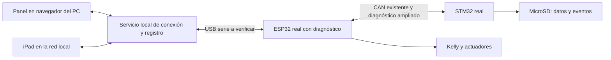

# Panel gráfico del kart real y calibración en ejecución

**Alcance actualizado después de la propuesta:** Armando aplaza iPad y prioriza portátil por cable, con laboratorio y osciloscopio disponibles. Primera aplicación local ya creada y comprobada sin hardware; placas aún desconectadas. [Arranque y pendientes](ARRANQUE_PANEL_PORTATIL_2026-10-07.md), [aplicación](../07_DESARROLLO/panel_local/README.md). Los apartados siguientes conservan la planificación inicial; iPad/red no forman parte de la implementación actual. Wi-Fi directo se estudiará después; calibración del firmware pendiente.

## Objetivo y elección del usuario

Armando elige observar las placas reales y ajustar valores desde una interfaz gráfica, evitando regrabar el firmware para cada ajuste. Quiere explorar PC e iPad y visualizar conexiones/entradas/salidas. Aclara después que «autofrenado» se refiere a frenado regenerativo para recargar la batería; desconoce si su controlador lo permite. Realimentación y regeneración son ideas exploratorias, no requisitos definitivos: pide analizar qué mejoras son necesarias y reales. [DEC-0002](../05_DECISIONES_Y_PROBLEMAS/decisiones/DEC-0002_panel_real_y_calibracion.md) registra la elección de enfoque, sin dar por elegidos aún parámetros ni detalles técnicos.

La propuesta es un panel de supervisión, adquisición y calibración: cada placa mantiene su firmware y ejecuta su control. El panel modifica solo parámetros expuestos por ese firmware. Cambiar una ganancia, un umbral o un perfil preparado puede evitar recompilación; añadir un algoritmo, periférico o tipo de dato nuevo requiere actualizar el firmware. El mismo catálogo versionado de señales/parámetros permite generar controles del panel y evitar descripciones incompatibles.

Se prepara una maqueta interactiva de conversación con datos de ejemplo. No está conectada a hardware, no representa mediciones ni modifica el kart. En esta sesión no se ha creado el servicio de conexión, cambiado los fuentes originales ni grabado las placas.

Comprobación de maqueta: renderizada con el envoltorio de Visualize y revisada en Edge sin ventana visible. Funcionan selección de señales, borrador separado del activo, confirmación ilustrativa, guardado de perfil de ejemplo, bloqueo con movimiento/pérdida de enlace y retirada de valores obsoletos. Sin errores JavaScript ni desbordes en las tres vistas a anchuras de navegador 1024, 375 y 320 px; capturas PC/móvil revisadas. Esto verifica la maqueta, no firmware, transporte, compatibilidad Safari/iPad real ni protecciones del kart.

## Evidencia local, configuración 2025/26

Fuentes: [inventario](../04_CONOCIMIENTO/software_y_telemetria/INVENTARIO_CODIGO.md), [fichas DOC-0032](../03_CATALOGO/fichas/DOC-0032.md) y [DOC-0034](../03_CATALOGO/fichas/DOC-0034.md), y fragmentos propios del código entregado. Montaje y firmware actualmente grabados por confirmar. No se asume configuración histórica de batería como actual.

Ruta base del código: `02_ORIGINALES/entrega_2026-09-28/Smart Eletric Kart Cross-2223406-2223403/Smart Eletric Kart Cross-2223406-2223403/`.

- `ESP32-final/ESP32-final/ESP32-final.ino`: puerto serie iniciado a 115200 bit/s en línea 237. Contiene mensajes de arranque/eventos, no un protocolo completo para el panel. Conector físico, puente USB-serie, alimentación, DTR/RTS y efecto de abrir el puerto por comprobar antes de conectar; abrir un puerto puede provocar reset según la placa/herramienta.
- ESP32, líneas 426–434: `0x123` transmite velocidad, rpm izquierda/derecha y yaw escalado ×10. La periodicidad de 200 ms consta en líneas 381–384 ya revisadas. No incluye PWM, relés, fallos ni revisiones de parámetros.
- ESP32, líneas 351–368 ya revisadas: `0x100` lleva mandos recibidos del STM32. Un valor recibido/procesado no es necesariamente la lectura ADC física sin transformar: diagnosticar ADC crudo requiere telemetría específica del STM32.
- ESP32, líneas 31–33: PWM 5 kHz, 8 bits. GPIO32/2 para órdenes de motor y 16/17 para relés según encabezado revisado. El panel debe distinguir valor software, duty emitido y tensión física después del optoacoplador/filtro; no atribuir una medición eléctrica a `ledcWrite`.
- ESP32, líneas 455–493: si se recibe freno se llama a parar motores; con acelerador cero se ordena parada. La rampa se calcula en 473–483 pero las funciones de modo reciben `acelerador_pct`, no ese PWM calculado. No basta añadir un deslizador para que la rampa se aplique.
- ESP32, líneas 510–515 (búsqueda focalizada): señales de freno siempre LOW y PWM de freno 0 en la parada. No hay una función de frenado eléctrico/regenerativo validada en estos fragmentos. Reducir par, frenar activamente y regenerar son funciones diferentes; revisar Kelly/BMS/cableado antes de proponer la última.
- STM32, `STM32-final/Core/Src/main.c`, líneas 348–383: apertura del CSV, cabecera y campos de `SD_Log`. El inventario verifica registro periódico cada 200 ms y sincronización cada segundo. La SD existe, pero el firmware entregado no demuestra captura de todos los eventos con alta resolución ni registro de batería/configuración.
- STM32 no usa UART/USB de diagnóstico en el proyecto inventariado. La pantalla y la SD tienen problemas de mantenimiento ya registrados; no presuponer que el USB de la Discovery entrega las variables del kart sin configurar firmware/rutas físicas.

## Arquitectura recomendada por etapas

Primera implementación propuesta: ESP32 como punto de diagnóstico serie; pequeño servicio local en Python con lectura serie, API y transmisión de telemetría al navegador. HTML/JavaScript para interfaz adaptable a PC/tablet. El servicio conserva sesiones y perfiles. Herramientas/librerías exactas se seleccionarán al implementar; no hay que instalar una app nativa de iPad para empezar.

El PC puede servir el mismo panel al iPad por la red local una vez configurados red y acceso. El PC sigue conectado por cable y debe permanecer encendido. Primero acceso local del PC; después habilitación explícita de acceso de red con autenticación/emparejamiento y un único cliente con permiso de escritura. No se abre ningún puerto ni cambia firewall en esta sesión.

El ESP32 podría enviar al PC sus variables y los mensajes CAN que ya recibe. Para ver todas las entradas y estados propios del STM32 hay que ampliar su diagnóstico por CAN o preparar un canal aparte; el gateway no puede inventar variables que no recibe. Añadir tráfico requiere medir carga y priorizar `0x100`, evitando interferir con el timeout de 100 ms existente.

Alternativas:

| Ruta | Utilidad | Trabajo/condición pendiente |
|---|---|---|
| PC por USB + navegador/iPad mediante servicio local | Primera opción propuesta: mismo panel y captura en PC | Puerto/USB real, masas/alimentación, firmware de diagnóstico y servicio local |
| Adaptador USB-CAN adecuado | Observar el bus sin depender del gateway ESP32; diagnóstico independiente | Adaptador/aislamiento/conexión correctos; CAN actual no contiene todas las variables; recepción pasiva primero |
| ESP32 por Wi-Fi, panel en navegador | PC/iPad sin PC puente si ESP32 sirve el panel | Recursos, tareas, latencia, autenticación y comportamiento con pérdida de red; evaluar después |

Wi-Fi y el PC nunca se proponen como parte del lazo rápido de control. El kart continúa ejecutando control y protecciones en los micros. La visualización puede actualizarse a 10–20 Hz como objetivo de diseño; esto no aumenta automáticamente la frecuencia de los sensores (por ejemplo, CAN `0x123` actual a 5 Hz). Muestreo, emisión y refresco deben verse separados y medirse. No prometer tiempo real determinista ni captura de cada flanco con una animación.

## Cómo se vería y cómo se usaría

1. **Mapa de placas y señales:** seleccionar STM32, ESP32, CAN, BMS o una salida. Mostrar origen, destino, pin, unidades, orden lógica, medición disponible y tiempo desde la última muestra. Estado desconocido se muestra desconocido, no verde.
2. **Trazas:** rpm por rueda, pedal procesado/ADC cuando disponible, ángulo/yaw, PWM bruto y orden de marcha; seleccionar pocas señales, guardar sesión y revisar momentos de fallos. Un cable dibujado es conectividad declarada/documentada, no prueba de continuidad.
3. **Calibración:** parámetro candidato, valor activo leído del micro, borrador, unidades/rango permitido, condición para modificarlo y botones de aplicar temporalmente, descartar borrador y guardar perfil. Los límites definitivos se acuerdan tras revisar algoritmo y hardware.
4. **Eventos:** arranque, motivo de reset, CAN perdido, cargador, START/STOP, cambios aceptados/rechazados y errores SD, con origen y marca de tiempo. Falta de telemetría indica pérdida de observabilidad; no diagnostica por sí sola un fallo del micro.

Ejemplo de interacción, no requisito elegido: editar una ganancia de corrección de yaw, aplicar el borrador en banco detenido, recibir la revisión y valor aceptados del ESP32, observar la respuesta en un ensayo preparado y guardar el perfil que interese. No afirmar que exista hoy una ganancia expuesta ni asignarle un rango seguro sin análisis. La rampa exige corregir primero la ruta que no la usa. La regeneración solicitada como idea requiere identificar modelo/configuración Kelly, ruta de mando, aptitud de batería/BMS para aceptar energía y condiciones de operación antes de diseñarla; no habilitada por un botón. Priorizar diagnóstico/registro y después elegir ajustes necesarios basados en resultados.

## Protocolo y aplicación de cambios

- Inicio de sesión: versión de firmware, identidad del nodo, versión del protocolo/esquema, capacidades, configuración activa y reinicio/sesión. El panel adapta los campos a capacidades reales.
- Telemetría con nodo, secuencia, timestamp de origen, unidades y validez. El PC añade tiempo de recepción. Relojes STM32/ESP32 no se consideran sincronizados automáticamente; alinear con intercambio de referencia o marcar incertidumbre.
- Comando de configuración con identificador, revisión de base, parámetro/valor y modo de aplicación. Permitir solo una lista de parámetros conocida, valores finitos y dentro del rango y estado permitidos; la validación vive en el micro, además del panel.
- El micro aplica un conjunto coherente al inicio de un ciclo y responde aceptado/rechazado, valor efectivo, revisión y motivo. Recepción del mensaje no equivale a aplicación. El panel no muestra éxito hasta confirmación y lectura coherentes; un ACK perdido deja estado indeterminado y se consulta, sin reintentos de actuación ciegos.
- Cambios de control inicialmente solo con banco habilitado, N y ruedas detenidas. Tras ensayos, algunos parámetros podrán permitir ajuste durante un ensayo de banco dentro de límites; no es una autorización general de escritura en marcha.
- Primero calibración del ESP32. Para parámetros que afecten ambos micros, definir coordinación, revisiones y recuperación; una transmisión CAN no hace una actualización multinodo atómica.
- Separar configuración de entradas/actuación. Los deslizadores iniciales no suplantan pedal/freno ni mandan PWM directo. Inyección de pruebas, si se añade, será un modo explícito con montaje y condiciones definidos.
- Al cerrar/perder el panel, no se dejan órdenes de prueba latentes. El control autónomo conserva una configuración previamente validada; la transición de salida del modo de calibración se define en firmware. No introducir parada por pérdida de Wi-Fi en el control ordinario sin definir su función.
- Diagnóstico con colas/buffers acotados, prioridad menor que control y contadores de pérdidas; evitar `Serial.print` bloqueante por cada iteración. Escrituras persistentes fuera del lazo crítico.
- Botón visual de detener, si se añade, es una orden de software con confirmación; no sustituye un corte físico independiente.

## Perfiles y persistencia

Mientras se ajusta, cambios temporales en RAM. Guardado explícito de una configuración elegida, sin escribir flash por cada movimiento del deslizador. ESP32 puede usar NVS/Preferences; valorar una estructura versionada, validada y recuperable frente a corte de alimentación. No aplicar esa API a STM32.

Perfil en PC con firmware/esquema compatibles, fecha, parámetros, unidades, revisión y notas; firmware guarda versión/revisión activa y recupera un perfil válido o valores de respaldo al arrancar. El fallo de alimentación/energía residual pendiente hace especialmente necesario verificar guardado incompleto, reinicio y recuperación. Volver a un perfil restaura parámetros compatibles, no revierte firmware ni calibra por sí mismo el hardware.

## MicroSD y eventos

Conservar el CSV de referencia. Ampliar por etapas versión/configuración, estados y batería cuando su decodificación esté contrastada. Eventos con timestamp del micro y cola acotada: capturar un cambio cuando ocurre, escribir por lotes sin bloquear el control y contar pérdidas/desbordes. Un timestamp de milisegundos no demuestra esa precisión en el instante detectado ni evita pérdidas por sondeo/RTOS.

Guardar también en PC la telemetría recibida y los cambios. Asociar ambas trazas por sesión/reinicio/secuencia y referencia temporal; no basarse solo en la hora del ordenador. Revisar el defecto de reanudar SD y exclusión mutua antes de prometer registro continuo. Un corte brusco puede perder eventos aún no volcados: diseñar sincronización/recuperación y medir el efecto.

## Plan, resultados comprobables y tiempo

Horas de trabajo técnico del conjunto; estimación propia, preliminar, sin cadena de compilación reconstruida ni medición en placa. Las filas son incrementales y se suman.

| Etapa | Resultado comprobable | Estimación |
|---|---|---:|
| 1. Base y conexión | v0 verificada, dependencias fijadas, versiones, identificación del puerto/montaje y captura serie/CAN de referencia | 4–8 h |
| 2. Panel de lectura | Telemetría ESP32 + datos CAN disponibles, mapa, datos antiguos visibles y registro en PC | 12–24 h |
| 3. Calibración inicial | Un parámetro efectivo, validación en micro, ACK/readback, persistencia y perfil compatible | 12–24 h |
| 4. Integración frontal/eventos | Diagnóstico STM32, ampliación de señales, SD/eventos y prueba del impacto temporal | 8–16 h |
| 5. Acceso iPad y contraste | Interfaz táctil, acceso local autenticado, pruebas de reconexión y trazas verificadas | 4–8 h |

Primera versión de lectura: 16–32 h (etapas 1+2). Conjunto básico integrado: 40–80 h, varias sesiones o semanas según dedicación y dificultades. Wi-Fi directo en ESP32 podría añadir 12–24 h tras verificar recursos; nueva función de frenado no presupuestada porque faltan requisitos/hardware. Depuración de fallos heredados puede ampliar estos rangos. No son tiempos de respuesta garantizados de IA.

Operación del panel diseñado sin IA: sin tokens de OpenAI por abrirlo/ajustar/registrar. Desarrollo asistido y cambios solicitados sí usan cuota; no convertir horas en tokens ni en dinero automáticamente. Inventario de cables/adaptadores/licencias pendiente; no comprar instrumentos por esta nota.

## Fuentes oficiales consultadas el 07-10-2026

- [ASAM XCP](https://www.asam.net/standards/detail/mcd-1-xcp/): medición de variables y calibración de parámetros de ECU, incluida modificación sin recompilar para tareas de calibración. Fundamenta la separación entre control y calibración. Se propone inicialmente protocolo acotado propio, no cumplimiento XCP/A2L ni acceso arbitrario a memoria. Evaluar XCP después si hace falta interoperabilidad.
- [Espressif Preferences](https://docs.espressif.com/projects/arduino-esp32/en/latest/api/preferences.html): almacenamiento no volátil ESP32. Tecnología candidata; formato, validación y recuperación deben implementarse.
- [Espressif HTTP Server](https://docs.espressif.com/projects/esp-idf/en/stable/esp32/api-reference/protocols/esp_http_server.html): servidor HTTP y soporte WebSocket como posibilidad de transporte. No demuestra integración con el sketch actual ni latencia garantizada.
- [MDN Web Serial](https://developer.mozilla.org/en-US/docs/Web/API/Web_Serial_API): disponibilidad limitada entre navegadores. Evitar basar compatibilidad iPad en acceso directo a un puerto serie desde el navegador; la ruta recomendada es navegador→servicio del PC por red local.

## Pantalla frontal y cobertura

Armando declara una franja horizontal blanca en la parte superior que limita el área útil. Anchura/altura en píxeles, causa y comportamiento táctil pendientes. [PROB-0004](../05_DECISIONES_Y_PROBLEMAS/problemas/PROB-0004_franja_blanca_pantalla_frontal.md). Registrar la zona afectada y evitar ubicar allí información esencial en un futuro diseño; no dar por averiada toda la lógica ni proponer sustituir hardware sin comprobar. El panel externo no depende del área visible de esa pantalla.

Consulta focalizada: estado/mapa/índice, inventario, fichas de placas, decisión de versiones, propuesta anterior, notas de problemas e ideas. Fuente ESP32: búsquedas de símbolos y líneas 426–496; STM32: líneas 348–383. No se leyeron completos manuales, planos o bibliotecas, ni se recuperaron nuevas páginas PDF. No se cierra ningún lote de lectura. No se compiló, conectó, regrabó, midió ni publicó nada.
