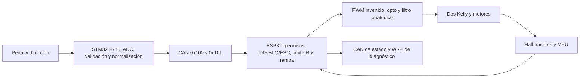

# Diferencial, reversa y ruido: diagnóstico y plan

Armando solicita primero revisar, mostrar soluciones y presentar el plan; después se implementará. **No se modifica ni se graba firmware en esta sesión.** Se ejecutan comprobaciones aisladas en PC y se documentan sus límites. [ENS-0025](ensayos/ENS-0025_revision_diferencial_y_reversa.md) conserva procedimiento, resultados y fuentes.

## Observación actual y diagnóstico

**Declaración de Armando, 17-10:** pruebas en banco, ruedas siempre elevadas; pantalla indica aproximadamente 50 km/h en R en cualquiera de DIF/BLQ/ESC, con giro audible muy rápido. No es una medición de velocidad de desplazamiento ni hay registro instrumental recibido. También informa de mucho ruido electromagnético que atribuye a los diferenciales y que afecta dirección y otros sensores; señal de referencia turbia/inconsistente. Frecuencias, amplitudes, punto de medida y mecanismo de acoplamiento pendientes. No atribuir automáticamente el síntoma a poca carga de las ruedas, a una avería de sensor o a EMI.

| Hallazgo | Evidencia y alcance | Consecuencia |
|---|---|---|
| v1.2 no aplica límite de reversa | `ESP32-v12.ino`, commit `905b09e`: `REVERSE_SPEED_LIMIT 1.0` solo aparece en su definición (línea 38). `processarComando`, líneas 524–577, llama a los modos y después cambia D/R, sin limitación por velocidad | Defecto concreto del programa conservado, compatible con el síntoma en los tres modos |
| Reproducción v1.2 | Tres casos PC, dirección centrada, pedal completo, R ya seleccionada, RPM sintéticas equivalentes a unos 50 km/h: PWM I/D = **0/0**, que en esta lógica significa mando completo | Demuestra ausencia de corte en ese fuente; no identifica el firmware físico ni mide 50 km/h |
| v1.3-dev3 sí tiene supervisor común de R | `kart_control.cpp`, líneas 140–149: máximo de ambas ruedas, techo de mando, reducción desde 18, corte a 20 y recuperación a 19 km/h estimados | Con RPM válidas de 50 corta en los tres modos en PC; no hay evidencia de su instalación en ESP32 |
| Identidad física pendiente | Capturas F746 ENS-0019/0023: llega 0x123, no 0x124. Última grabación documentada ESP32: v1.2; declaración posterior «B1.3» sin identificación | Indicio de firmware anterior, no prueba concluyente. Actualizar F746 no actualiza el ESP32 |
| Rampa dev3 altera reparto | En inicio con dirección +20° nominal, razón mando derecho/izquierdo = **1**, frente a objetivo geométrico **0,754404**; ocurre en D y R. Tras asentarse, coincide | Corregir rampa para conservar proporción del reparto, manteniendo reducción/parada inmediata |
| Histéresis dev3 no observa exceso a pedal libre | En los tres modos: 21 km/h sintéticos con pedal cero → 19,5 con pedal pisado permite mando; el retorno temprano omite actualizar `reverse_cut_` | Actualizar memoria de supervisión también durante circulación sin pedal. Este defecto **no explica por sí solo** los 50 km/h observados |
| PWM/porcentaje no demuestra velocidad | DIF/BLQ actúan sobre esfuerzos, sin seguimiento de RPM por rueda. La rampa en «rpm/s» también es una rampa de mando normalizado | Separar consigna de velocidad, esfuerzo eléctrico y velocidad medida |

Fuentes preservadas y logs: [evidencia de la revisión](evidencias/revision_diferencial_2026-10-17/README.md). Problemas: [PROB-0014 · reversa y arquitectura](../05_DECISIONES_Y_PROBLEMAS/problemas/PROB-0014_reversa_y_arquitectura_diferencial.md), [PROB-0015 · ruido declarado](../05_DECISIONES_Y_PROBLEMAS/problemas/PROB-0015_ruido_electromagnetico_sensores.md).

## Arquitectura que existe



El frontal de trabajo toma una muestra ADC por canal por ciclo nominal de 5 ms (`main.c` 925–937; `kart_frontend.c` 129–140, 162–170). Rechaza fallos/rango, pero no filtra ruido dentro de rango. Normaliza dirección física 1042–3313 a 0–4095; el ESP32 interpreta ese valor con centro 2047, topes 1089/3005 y ±20°. Son constantes heredadas, no una calibración actual. El perfil visual del PC no se transfiere al controlador. Es necesario verificar toda la cadena ADC físico → CAN normalizado → ángulo de rueda equivalente, sin confundirlo con ángulo del volante.

En dev3, Hall usa ventanas nominales de 100 ms y tiempo realmente transcurrido; PPR izquierdo/derecho 89/68 históricos. Límite de caducidad 250 ms y presencia de pulso reciente de 300 ms. El rechazo de flancos separados menos de 100 µs no demuestra inmunidad a EMI. Un Hall en cero no distingue inmovilidad de cable desconectado; la vigilancia tras exigir movimiento ofrece detección parcial, no redundancia completa.

El CAN 0x123 muestra **media de RPM convertida a km/h**, mientras el supervisor y Wi-Fi dev3 usan la **rueda más rápida**. La pantalla sola no acredita el límite por rueda. 0x124 permite ver actuación y validez, pero no transporta versión exacta ni umbral numérico. Wi-Fi sí incluye `fw` y `reverse_limit_kph` en dev3. La ausencia de 0x124 no identifica inequívocamente una versión.

El motor izquierdo está invertido por software (`hardware_kart.h`, `LEFT_INVERTED=true`; aplicación de salidas en `main.cpp`). Una eventual limitación «reverse» dentro de cada Kelly **no puede configurarse suponiendo que R del kart sea reverse en ambos controladores**: hay que verificar la correspondencia de los dos lados.

## Matemática y significado de los modos

Para velocidades de rueda (sin deslizamiento), batalla L, vía W, diámetro D, ángulo equivalente δ positivo a la derecha y velocidad central firmada v:

```text
k = W tan(δ) / (2L)
v_izq = v (1 + k)
v_der = v (1 - k)
yaw_ref [rad/s] = v tan(δ) / L
rpm_rueda = 60 v_rueda [m/s] / (π D)
velocidad [km/h] = rpm_rueda × π D × 0,06
```

La forma con `tan(δ)` evita dividir por un radio infinito al ir recto. En R cambia el signo de v y del yaw esperado; para el mismo giro no se intercambian sin más las magnitudes izquierda/derecha. La guiñada del MPU debe transformarse a la misma convención, midiendo su orientación real.

**Ejemplo de cálculo, no medición:** con L=1,3 m, W=1,0 m y δ=20° del Config dev3, k≈0,13999 y la razón interior/exterior es 0,754404. Con D=0,48 m, 20 km/h equivalen a ≈221,05 rpm de rueda, y 570 rpm a ≈51,57 km/h. Por eso el techo de mando actual es ≈0,388; no significa que 38,8 % de mando produzca 20 km/h. El informe DOC-0042 PDF 56 usa radio 0,243 m, frente a D=0,48 m del código nuevo: discrepancia de escala del 1,25 %, pendiente de medir, insuficiente por sí sola para explicar 20→50.

| Modo | Lo que hace el programa | Propuesta |
|---|---|---|
| DIF | Reparte mando según geometría; no obliga a que las RPM sigan esa proporción | Conservar fórmulas/signos, corregir rampa/saturación y distinguir reparto de mando de seguimiento de velocidades. Caracterizar Kelly antes de añadir lazo por rueda |
| BLQ | Iguala mandos con ganancias nominales iguales; no mide ni corrige diferencia de velocidades | Mostrar «mando igual». Si se desea bloqueo electrónico de velocidades, diseñarlo explícitamente con feedback y límites de corriente/esfuerzo, sin presentarlo como bloqueo mecánico |
| ESC | DIF más corrección de error de guiñada; ganancia 1/200, zona de 2 °/s y máximo 10 % de base son de desarrollo | Verificar signos D/R, simetría, datos recientes y límites. Ajuste dinámico posterior con sensores estables; mantenerlo experimental |

**Ruedas elevadas:** sirven para comprobar dirección, PWM, RPM, límites y fallos, pero el chasis no gira como al circular. El ESC puede ver yaw≈0 aunque las ruedas giren rápido y pedir compensación; ese banco no valida estabilidad ni permite ajustar el control dinámico por sí solo.

Kelly documenta modos de par, velocidad y mixto; por ello se debe leer la configuración real de cada controlador antes de interpretar el acelerador como referencia de velocidad. [Fabricante Kelly KEB](https://kellycontroller.com/shop/keb/), consultado el 17-10-2026; DOC-0031 PDF 5/impresa 4. No se afirma cuál está instalado/configurado.

## Plan propuesto, en orden

| Etapa | Trabajo concreto | Criterio de salida |
|---|---|---|
| 1. Identidad y escalas | Leer identificación ESP32 por Wi-Fi, versión frontal y configuración Kelly; conservar logs y correspondencia D/R por lado. Contar PPR y contrastar RPM con referencia independiente, identificar diámetro/relación de transmisión | Fuente/binario/configuración vinculados; RPM utilizables. Puede avanzarse en correcciones locales mientras se prepara esta identificación, después de aceptar el plan |
| 2. Prioridad reversa | Mantener un único supervisor independiente de DIF/BLQ/ESC; actualizarlo aunque el pedal esté libre. Utilizar máximo de ambas ruedas, validez/frescura, reducción anticipada y corte común; no convertir ausencia de datos en permiso. Conservar STOP, freno, timeout y rearme | En PC, ningún modo ordena aceleración con velocidad válida ≥20; memoria de corte hasta ≤19 incluso al soltar pedal; señales inválidas inhiben. En banco, confirmar actuación y medir retraso/sobrepaso |
| 3. Reparto y rampa | Corregir rampa común y saturación proporcional, verificar simetría y dirección. Separar unidades/magnitudes y etiquetar BLQ correctamente | Proporciones de mando conservadas desde el primer paso; prueba D/R, ambos giros, centro, pedal parcial/pleno y cambio de modo detenido |
| 4. Observabilidad y ruido | Registrar entrada sin filtrar, filtrada, ángulo, consigna por rueda, RPM/edades, factor de limitación, motivo y configuración. Caracterizar EMI con osciloscopio y luego elegir acondicionamiento/filtro | Evidencia temporal/espectral y mejora cuantificada sin ocultar fallos ni introducir retardo excesivo |
| 5. Seguimiento de velocidad y ESC | Según el modo real del Kelly, calibrar mapa de entrada o diseñar regulación de RPM por rueda. Si se añade PI, incluir saturación, anti-windup y reinicio en fallos/transiciones. Ajustar ESC en condiciones con respuesta real de guiñada | Seguimiento medido y límites acotados; estabilidad no se da por validada en banco elevado |
| 6. Entrega e instalación | Versionar, compilar ambos extremos si cambia contrato, conservar binarios/hashes y rollback; instalación coordinada y lectura de versión posterior | Evidencia del software realmente ejecutado y matriz física completada. ESP32 USB solo fuera del kart; ensayo instalado por Wi-Fi |

No se propone simplemente cambiar `REVERSE_SPEED_LIMIT` de 1.0 a 0.4: además de estar sin uso en v1.2, un porcentaje no establece un máximo de velocidad real.

Para el corte a 20, el margen de reducción debe considerar incertidumbre de velocidad, periodo Hall, latencia y aceleración máxima observada. Propuesta de diseño: `margen >= error_velocidad + aceleración_max × latencia_total + reserva`; cuantificar antes de fijar números. Los umbrales 20/19 existentes se conservan como requisito/valor inicial de prueba, no como tolerancia física demostrada. Sin frenado implementado, cortar mando no garantiza un techo instantáneo frente a inercia o arrastre externo. En banco se medirá el pico transitorio y la deceleración; no se prometerá «nunca supera 20» antes de ese ensayo.

La rampa de mando propuesta puede usar un único factor λ para ambos objetivos: `λ = min(1, (u_prev_i + Δu)/u_obj_i)` sobre los objetivos positivos; aplicar `u_i=λ·u_obj_i`, con ceros explícitos. Así cada aumento queda acotado y se conserva la proporción, permitiendo reducción inmediata. Revisar transiciones y saturaciones con tests antes de adoptarlo. Si después se añaden lazos independientes de velocidad, la proporción que se exige es la de **referencias de RPM**; los esfuerzos necesarios pueden ser diferentes.

## Caracterización y filtrado de la interferencia

Registrar el hallazgo como **ruido declarado por Armando, fuente/acoplamiento por confirmar**, vinculado también a [PROB-0007](../05_DECISIONES_Y_PROBLEMAS/problemas/PROB-0007_variacion_y_centro_direccion.md) y [PROB-0012](../05_DECISIONES_Y_PROBLEMAS/problemas/PROB-0012_pedal_reposo_fuera_de_pedal_libre.md). Un algoritmo no emite EMI por sí mismo: deben distinguirse etapas de potencia, PWM/opto, alimentación/masa, cableado y adquisición.

1. Comparar sensor inmóvil con potencia inactiva, controladores habilitados sin aceleración y excitación de cada lado/ambos a puntos de operación controlados. Identificar fuente, estado de carga, selector/modo, temperatura, cableado, posición de dirección y versiones en cada captura.
2. Medir señal de dirección en sensor y entrada ADC, alimentación/referencia ADC, pedal y Hall afectados, y salida analógica hacia Kelly. Conservar trazas originales y ajustes de sonda, escala, ancho de banda, frecuencia de muestreo y FFT. Usar referencia/sonda compatible con los dominios aislados; no unir GND-ESP y GND-Controlador con masas de osciloscopio por suposición.
3. Cuantificar pico a pico, dispersión con entrada inmóvil, frecuencias/harmónicos y correlación con cada accionamiento. Separar ruido conducido, acoplamiento radiado, masa/referencia inestable, saturación y aliasing. El PWM ESP32 es 5 kHz en código; la ficha de la familia KEB indica 16,6 kHz. Son candidatos de contraste, **no frecuencias medidas** del montaje.
4. Priorizar corregir conexiones/retornos, desacoplo y rutas de señales según resultados. Diseñar filtro analógico de entrada/anti-alias con impedancia del sensor y tiempo de adquisición ADC reales; `fc=1/(2πRC)` solo es la relación ideal para un polo RC. El RC de salida PWM→Kelly es otro circuito y tiene otro propósito.
5. Después probar filtro digital de dirección: mediana corta para impulsos y paso bajo con periodo real (`α=1−exp(−dt/τ)`), comparando atenuación y retardo. Son opciones por evaluar, **sin coeficientes ni corte elegidos todavía**. Conservar datos brutos y validar rango/frescura antes del filtro; no retener indefinidamente el último valor. No suavizar STOP/freno ni ocultar sobrevelocidad con un promedio lento de Hall.

La adquisición frontal nominal de 200 Hz y la telemetría de 5 Hz no permiten identificar por sí solas interferencia de kHz. Un filtro digital posterior no elimina el alias ya generado; se requiere atenuación antes de muestrear cuando corresponda. [Analog Devices, filtros de ADC](https://www.analog.com/en/resources/analog-dialogue/articles/practical-filter-design-precision-adcs.html), consultado el 17-10-2026. Medir también la latencia de la cadena completa, especialmente si se modifica el filtro de salida hacia Kelly.

DOC-0042 PDF 43/45 describe opto, dominios de masa y RC de salida; son antecedentes de julio, no componentes verificados hoy. No se adopta automáticamente su propuesta de resistencia ni se confunde ese filtro de acelerador con uno de sensores.

## Aceptación pendiente

- PC: matriz DIF/BLQ/ESC × D/R × centro/izquierda/derecha × pedal; límites justo debajo/en/encima de 20, cada rueda por separado, 50, Histéresis 20→19,5→19, liberación/pulsación, pérdida/caducidad Hall/MPU/ADC/CAN, STOP/freno y cambios de modo/dirección.
- Banco: primera validación con umbral reducido acordado, aumentando solo tras comprobar corte, referencia de RPM independiente y coherencia del signo. Ensayar cada modo y cada rueda; registrar tiempo hasta corte, pico transitorio, recuperación, PWM y tensión analógica. No buscar nuevamente 50 como condición necesaria.
- EMI: misma entrada/posición y condición eléctrica antes/después; espectro, dispersión, saturación y retardo, incluyendo efecto sobre el límite R. Si no mejora o introduce retraso excesivo, conservar resultado negativo y revisar diseño.
- Conducción/ESC: fase posterior, separada del banco, con geometría/sensores ya contrastados. La aprobación del código no certifica estabilidad ni eficacia física del límite.

**Siguiente acción:** revisar este plan con Armando; implementar después de su indicación. La observación física sigue abierta y no se declara resuelta.
