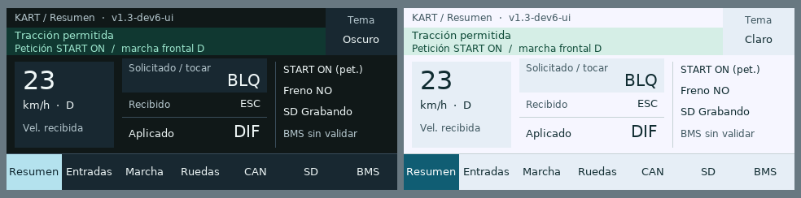
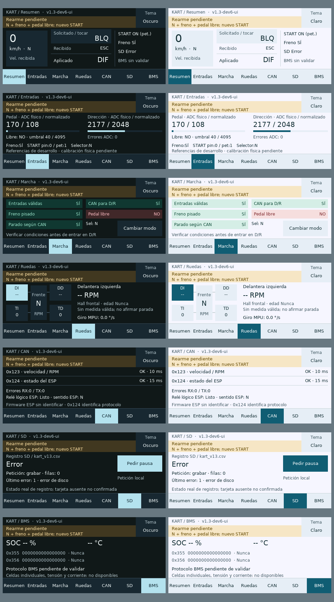

# Dashboard F746 · revisión visual en PC

Versión `stm32_frontal-v1.3-dev6-ui`, ENS-0022, 16-10-2026. **Datos sintéticos. No es una captura ni una fotografía de la F746.** Los renders reproducen las primitivas de `KartDashboard_Draw` y sus mapas de glifos alpha8, con color base cuantizado a RGB565. La composición final del LCD/TouchGFX, brillo, refresco y táctil necesitan prueba física.

Las comparativas recortan las filas 0–47 reservadas. Cada PNG individual conserva 480 × 272; el área útil es 480 × 224. Oscuro a la izquierda, claro a la derecha.

El escenario ilustra los modos solicitado BLQ, recibido ESC y aplicado DIF como estados diferentes; no representa un cambio aceptado en movimiento. START mostrado es petición lógica. En el escenario de rearme, el ADC 170/normalizado 108 ilustra el bloqueo por pedal; no es medición nueva del kart.

`renders.jsonl` conserva 120 dibujos completos emitidos por el arnés C++/C, con seis escenarios, ambos temas y las cuatro selecciones de rueda. `tools/renderizar_dashboard.py` reproduce sus PNG. Fuente/datos y comprobaciones enlazados desde [README](README.md).
