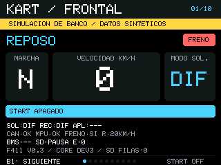
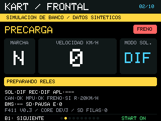
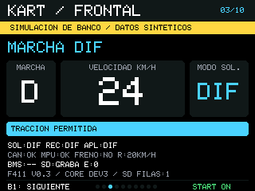
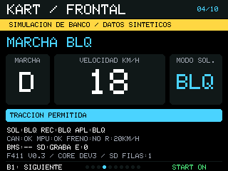
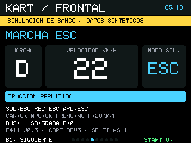
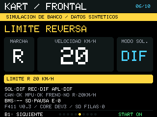
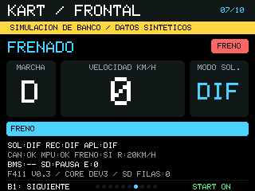
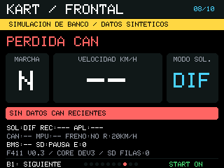
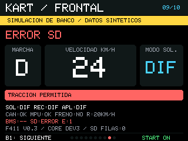
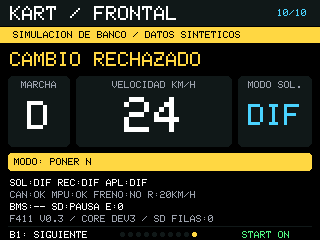

# Capturas del banco visual · ENS-0016

14-10-2026 · NUCLEO-F411RE + ILI9341 · firmware de banco v0.3.

**Origen:** lectura real de la memoria gráfica del LCD (GRAM), 320×240, RGB565. La interfaz se dibuja en la placa; el ordenador convierte esos píxeles a PNG. Son capturas digitales, no fotografías del cristal. Todos los datos del kart son sintéticos; no validan motores, CAN eléctrico, sensores, SD física ni TouchGFX en F746.

[Ensayo y límites](../../ensayos/ENS-0016_vistas_frontal_nucleo.md) · [Galería conjunta PNG](galeria.png) · [Manifiesto de captura](capturas_finales/manifest.json)

**Uso:** pulsar y soltar B1 azul avanza una escena; de la 10 vuelve a la 1. Mantenerlo pulsado no repite. START mostrado pertenece al escenario simulado.

## 01 · Reposo

N, 0 km/h, START apagado; modo aplicado desconocido. **Valores sintéticos.**

[PNG 960×720 sin interpolación](capturas_finales/escena_01_3x.png) · [Datos y CRC](capturas_finales/escena_01.json) · [RGB565 original](capturas_finales/escena_01.rgb565)

## 02 · Precarga

START activo; preparando reles virtuales; APL:---. **Valores sintéticos.**

[PNG 960×720 sin interpolación](capturas_finales/escena_02_3x.png) · [Datos y CRC](capturas_finales/escena_02.json) · [RGB565 original](capturas_finales/escena_02.rgb565)

## 03 · Marcha DIF

D, 24 km/h; grabacion simulada de una fila. **Valores sintéticos.**

[PNG 960×720 sin interpolación](capturas_finales/escena_03_3x.png) · [Datos y CRC](capturas_finales/escena_03.json) · [RGB565 original](capturas_finales/escena_03.rgb565)

## 04 · Marcha BLQ

D, 18 km/h; BLQ solicitado, recibido y aplicado. **Valores sintéticos.**

[PNG 960×720 sin interpolación](capturas_finales/escena_04_3x.png) · [Datos y CRC](capturas_finales/escena_04.json) · [RGB565 original](capturas_finales/escena_04.rgb565)

## 05 · Marcha ESC

D, 22 km/h; ESC solicitado, recibido y aplicado. **Valores sintéticos.**

[PNG 960×720 sin interpolación](capturas_finales/escena_05_3x.png) · [Datos y CRC](capturas_finales/escena_05.json) · [RGB565 original](capturas_finales/escena_05.rgb565)

## 06 · Limite de reversa

R, 20 km/h; aviso de limite de propulsion. **Valores sintéticos.**

[PNG 960×720 sin interpolación](capturas_finales/escena_06_3x.png) · [Datos y CRC](capturas_finales/escena_06.json) · [RGB565 original](capturas_finales/escena_06.rgb565)

## 07 · Frenado

D, 0 km/h; freno activo y motivo FRENO. **Valores sintéticos.**

[PNG 960×720 sin interpolación](capturas_finales/escena_07_3x.png) · [Datos y CRC](capturas_finales/escena_07.json) · [RGB565 original](capturas_finales/escena_07.rgb565)

## 08 · Perdida de CAN

Caducidad inducida: velocidad -- y marcha N. **Valores sintéticos.**

[PNG 960×720 sin interpolación](capturas_finales/escena_08_3x.png) · [Datos y CRC](capturas_finales/escena_08.json) · [RGB565 original](capturas_finales/escena_08.rgb565)

## 09 · Error de SD

FATFS simulado falla al montar: SD:ERROR E:1. **Valores sintéticos.**

[PNG 960×720 sin interpolación](capturas_finales/escena_09_3x.png) · [Datos y CRC](capturas_finales/escena_09.json) · [RGB565 original](capturas_finales/escena_09.rgb565)

## 10 · Cambio rechazado

Solicitud de modo con D: exige N y conserva DIF. **Valores sintéticos.**

[PNG 960×720 sin interpolación](capturas_finales/escena_10_3x.png) · [Datos y CRC](capturas_finales/escena_10.json) · [RGB565 original](capturas_finales/escena_10.rgb565)

