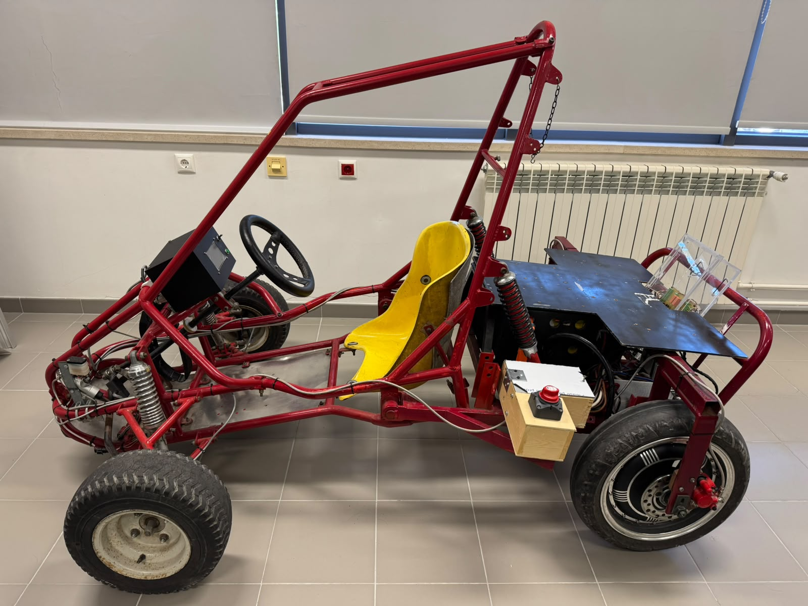
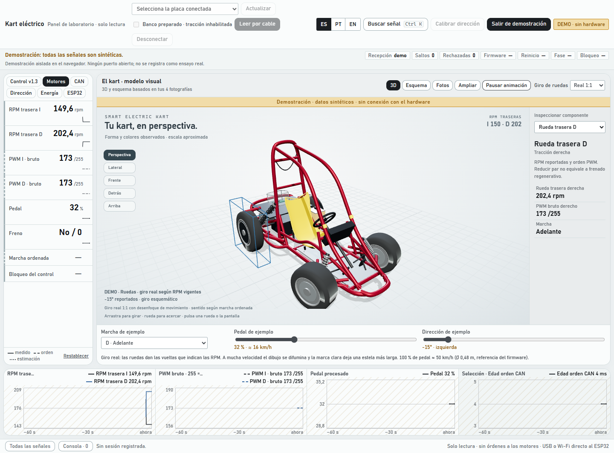

# Kart eléctrico · revisión académica 2026/27

**Avances hasta el 13 de octubre de 2026.** Documentación, software y evidencias de la continuación del Smart Electric Kart: diagnóstico del sistema heredado, telemetría por Wi-Fi, panel del portátil y mejoras de control STM32/ESP32.

**[Empezar por el dossier para profesores](00_INICIO/REVISION_PARA_PROFESORES.md)** · [Estado actual](00_INICIO/ESTADO_ACTUAL.md) · [Dejar una observación](https://github.com/armandos52/kart-electrico/issues/new/choose)

*Montaje fotografiado por el usuario; dimensiones, componentes ocultos y firmware instalado pendientes de contraste. [Procedencia: DOC-0044](03_CATALOGO/fichas/DOC-0044.md).*

## Qué se ha trabajado

| Área | Resultado disponible | Evidencia y límites |
|---|---|---|
| Base documental | 44 entradas: 42 documentos heredados, propuesta personal y conjunto fotográfico; extracción inicial de 1.007 páginas PDF | [Catálogo](03_CATALOGO/INDICE_DOCUMENTOS.md). Lectura técnica integral pendiente |
| Recuperación y diagnóstico | Respaldo ESP32 verificado, recuperación de la imagen original y telemetría Wi-Fi/USB v1.2 | [ENS-0001 a ENS-0004](06_TRABAJO/ensayos/README.md). Banco documentado; funcionamiento de motores declarado por Armando |
| Panel del portátil | Lectura sin transmitir mandos, registro, gráficas, 3D/esquema, idiomas ES/PT/EN y calibración por pasos | [Guía y arranque](07_DESARROLLO/panel_local/README.md). Demo sintética; calibración solo de la visualización |
| Control v1.3-dev3 | STOP/rearme, supervisión de entradas, modos, registro SD y memoria para START momentáneo | [Versiones](07_DESARROLLO/firmware/VERSIONES.md), [protocolo](07_DESARROLLO/firmware/common/PROTOCOLO_V13.md). Comprobaciones en PC y compilaciones; validación física pendiente |
| Trazabilidad | 13 fichas con resultados y 1 ensayo planificado, 10 problemas y 8 decisiones, con resultados favorables y fallidos | [Diario de ingeniería](06_TRABAJO/DIARIO_PARA_RELATORIO.md), [prioridades](06_TRABAJO/TAREAS.md) |
| Batería y carga | Tutorial documental 16S, cálculos y discrepancias de identificación | [Consulta del 13-10](04_CONOCIMIENTO/bateria_y_bms/TUTORIAL_CELDAS_Y_CARGA_16S.md). Sin carga, ajuste BMS ni SOC medido |

**Estado del vehículo:** el 08-10 Armando confirmó marcha satisfactoria tras preparar v1.2; el 13-10 comunicó un problema de relé con «B1.3». Esta última denominación no identifica los binarios de las placas. Las correcciones dev3 publicadas están comprobadas en PC; falta identificar/resguardar el frontal y validar en banco y kart. La publicación es una entrega para revisión, no una versión de firmware validada para circular.

## Ver el panel

*Captura de QA con datos sintéticos del 11-10; no es una medición del kart. [Asistente y resultados](06_TRABAJO/ensayos/ENS-0012_calibracion_por_pasos.md).*

Para consultar los avances no hace falta instalar nada. Para explorar la demo local, seguir el [arranque del panel](07_DESARROLLO/panel_local/README.md#arrancar). El servicio comienza desconectado; la demostración se activa manualmente. GitHub muestra documentación y capturas, no ejecuta el panel Python.

## Recorrido de revisión

1. [Dossier para profesores](00_INICIO/REVISION_PARA_PROFESORES.md): objetivos, trabajo realizado, resultados y preguntas para orientar la continuación.
2. [Índice de ensayos](06_TRABAJO/ensayos/README.md): localizar cada cambio, su tipo de evidencia y sus datos.
3. [Código y verificación](07_DESARROLLO/README.md): proyectos, requisitos y comandos reproducibles sin hardware.
4. [Catálogo y cobertura](03_CATALOGO/INDICE_DOCUMENTOS.md): procedencia de las fuentes y alcance real de lectura.
5. [Cómo comentar](CONTRIBUTING.md): observaciones en Issues o debate en Discussions, con documento, sección y versión.

## Organización y alcance público

| Carpeta | Contenido |
|---|---|
| [00_INICIO](00_INICIO/MAPA_DEL_PROYECTO.md) | Dossier, estado, mapa y cronología |
| [03_CATALOGO](03_CATALOGO/INDICE_DOCUMENTOS.md) | Inventario, fichas y cobertura de lectura |
| [04_CONOCIMIENTO](04_CONOCIMIENTO/integracion_del_kart/ESTADO_DOCUMENTADO_2025-26.md) | Síntesis por sistemas y referencias |
| [05_DECISIONES_Y_PROBLEMAS](05_DECISIONES_Y_PROBLEMAS/README.md) | Decisiones razonadas e incidencias abiertas |
| [06_TRABAJO](06_TRABAJO/DIARIO_PARA_RELATORIO.md) | Planes, sesiones, ensayos, datos y evidencias |
| [07_DESARROLLO](07_DESARROLLO/README.md) | Firmware, panel, herramientas y propuesta académica |
| [09_PLANTILLAS](09_PLANTILLAS) | Modelos de registro reutilizables |

Se publican el desarrollo, las notas, los registros seleccionados y tres fotografías del kart. Los originales históricos completos, las imágenes de flash, las credenciales y las sesiones locales permanecen conservados fuera de Git; las referencias **«solo local»** requieren la copia documental de trabajo. [Alcance y acceso a fuentes](02_ORIGINALES/README.md). Las dependencias mantienen sus licencias; [procedencia del software](07_DESARROLLO/README.md#procedencia).

El primer corte de entrega queda identificado por la etiqueta `revision-academica-2026-10-13`; la rama principal incorpora además [ENS-0014, plan de carga pendiente](06_TRABAJO/ensayos/ENS-0014_carga_completa_bateria_16s.md), añadido al cierre del mismo día. No hay sincronización automática ni copia independiente de todo el archivo configurada.
